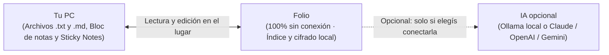

<div align="center">

  <a href="docs/media/folio-icon.svg">
    
  </a>

  # Folio

  **Todas las notas dispersas de tu PC, reunidas en un único cuaderno visual.**  
  <sub>Sin mover, importar ni encerrar tus archivos. 100% sin conexión y privado por defecto.</sub>

  <p>
    <a href="releases/Folio.exe"><strong>Descargar Folio (.exe)</strong></a> &nbsp;&bull;&nbsp;
    <a href="#por-qu-folio">¿Por qué Folio?</a> &nbsp;&bull;&nbsp;
    <a href="#funcionalidades-principales">Funcionalidades</a> &nbsp;&bull;&nbsp;
    <a href="#atajos-de-teclado">Atajos</a> &nbsp;&bull;&nbsp;
    <a href="#privacidad-y-arquitectura-offline">Privacidad</a> &nbsp;&bull;&nbsp;
    <a href="README.md"><strong>English</strong></a>
  </p>

  <br />

  

</div>

---

## ¿Por qué Folio?

Tus notas suelen quedar desparramadas por todos lados: pestañas sin guardar del Bloc de notas de Windows 11, Notas rápidas (Sticky Notes), y archivos `.txt` y `.md` sueltos en el Escritorio, Descargas y Documentos.

La mayoría de los programas de notas te exigen migrar, importar o encerrar tus ideas en formatos propietarios o servidores en la nube.

**Folio propone el camino inverso:**

1. **Cero migración**: Folio escanea las carpetas que elijas, lee las pestañas abiertas del Bloc de notas (incluso las no guardadas) y Sticky Notes, y las presenta en un cuaderno de papel rayado ordenadas por fecha.
2. **Edición en el lugar**: Folio no es una jaula. Cuando hacés doble clic en una hoja para escribir, **edita tu archivo `.txt` o `.md` original en el lugar exacto donde está en tu disco**, respetando su codificación y saltos de línea.
3. **100% sin conexión y privado por defecto**: Sin cuentas de usuario, sin telemetría, sin rastreo y sin depender de conexión a internet. Todo funciona en tu propia PC.

---

## Descarga y uso (Para usuarios)

Para usar **Folio** **no hace falta instalar herramientas de programación ni dependencias**:

1. Entrá a [**Releases**](../../releases) y descargá `Folio.exe` (o el archivo `.zip` de la versión).
2. Abrí `Folio.exe` directamente — está listo para usar en Windows 10 y Windows 11.

---

## Funcionalidades principales

### 1. Detección automática y sincronización en vivo
- **Recorre las carpetas elegidas**: Vigila tus ubicaciones preferidas salteando directorios de compilación o ruido (`node_modules`, `.git`, `AppData`, etc.).
- **Pestañas del Bloc de notas de Windows 11**: Lee las pestañas abiertas, incluso aquellas que aún no fueron guardadas en disco.
- **Sticky Notes**: Integra las notas rápidas de Windows en tu línea de tiempo.
- **Vigilancia del sistema de archivos en tiempo real**: Cuando un archivo cambia afuera, su hoja en Folio se actualiza de inmediato.

---

### 2. Escribir y dar formato sobre papel rayado


- **Doble clic para escribir**: Hacé doble clic en cualquier renglón de una hoja `.txt` o `.md` (o presioná `Enter`) para escribir. El cursor va exactamente al carácter donde hiciste clic.
- **Formato Markdown sobre el rayado**: Títulos, listas, casillas de tareas interactivas (`- [ ]`), tablas, bloques de código, citas y enlaces se dibujan alineados al renglón del papel.
- **Tareas interactivas**: Marcá o desmarcá tareas con un solo clic directamente sobre la vista Markdown.
- **Barra de formato y dictado por voz**: Botones rápidos de formato y un botón de micrófono para activar el dictado por voz de Windows (`Win + H`) sin perder el foco de escritura.
- **Notas nuevas como archivos reales**: Cada hoja nueva que creás en Folio (`Ctrl + N`) se guarda como un archivo `.txt` o `.md` estándar en `Documents/Folio`, pudiendo elegir su categoría desde el encabezado.

---

### 3. Captura desde cualquier programa


- **`Ctrl + Alt + B` (Abrir o minimizar Folio)**: Trae tu cuaderno al frente desde cualquier programa o lo vuelve a guardar en la bandeja al presionarlo de nuevo.
- **`Ctrl + Alt + N` (Hoja suelta rápida)**: Abre una hoja flotante siempre encima de las demás ventanas. Al cerrarla se guarda en el cuaderno; si querés descartarla, pide un segundo clic de confirmación por seguridad.
- **`Ctrl + Alt + X` (Enviar lo seleccionado a Folio)**: Seleccioná texto en cualquier navegador, lector de PDF, consola o editor y presioná `Ctrl + Alt + X`. Folio guarda el fragmento junto con la hora exacta, el programa y el título de la ventana de origen en una hoja de recortes **diaria** (`recortes-AAAA-MM-DD.txt`), **semanal**, **mensual** o **única**, o lo abre en una hoja suelta. Podés configurar si querés incluir u omitir el origen en Ajustes.

---

### 4. Categorías inteligentes y clasificador con IA opcional


- **Sugerencia de categorías 100% local**: Agrupamiento estadístico de palabras y catálogo de temas que analiza tus notas en la propia PC sin enviar ni un solo byte a internet.
- **Clasificación automática en segundo plano**: Clasifica notas nuevas (o sugiere tus categorías iniciales) usando el proveedor de IA que prefieras:
  - **Ollama**: 100% local, gratuito y sin conexión.
  - **Claude** (Anthropic)
  - **OpenAI** (modelos GPT)
  - **Gemini** (Google)
  - **Jev**
- **Seguridad en el llavero nativo**: Las claves API se guardan únicamente en el **Administrador de credenciales de Windows**, nunca en texto plano ni en la base de datos.

---

### 5. Skills para asistentes de IA (Claude Code, Codex y Gemini CLI)
- **Instalación en un clic**: Desde **Ajustes → Integraciones**, instalá las instrucciones y skills oficiales directamente en:
  - `~/.claude/skills/folio-notes/SKILL.md` (Claude Code)
  - `~/.codex/AGENTS.md` (Codex CLI)
  - `~/.gemini/GEMINI.md` (Gemini CLI)
- **Toma de notas para tus agentes**: Pedile a tus agentes de consola (`"anotá esto en Folio"`, `"guardá esta decisión de arquitectura"`) y tomarán notas formateadas con encabezado YAML (`titulo`, `categoria`, `etiquetas`, `fuente`, `fecha`) listas para leer en el cuaderno.

---

### 6. Cuaderno secreto cifrado (`XChaCha20-Poly1305`)
- **Detección automática de credenciales**: Las notas que contienen contraseñas, tokens de acceso o claves privadas se apartan automáticamente al `secret-book`.
- **Aisladas de búsquedas y clasificadores**: Quedan fuera de la búsqueda global de texto y de las consultas a IAs.
- **Cifrado autenticado**: Se guardan cifradas en SQLite con `XChaCha20-Poly1305` mediante una clave gestionada por el Administrador de credenciales del sistema.
- **Clave de respaldo exportable**: Podés copiar tu clave de respaldo desde **Ajustes → Datos** para restaurar tus notas secretas en otro equipo o tras reinstalar el sistema.

---

### 7. Historial de versiones y recuperación de archivos
- **Instantáneas automáticas de versión**: Conserva versiones anteriores de tus notas (agrupadas por sesión de edición).
- **Recuperación tras borrado accidental**: Si borrás un archivo original o cerrás una pestaña sin guardar en el Bloc de notas, Folio mantiene la última versión conocida en **Ajustes → Datos**.
- **Renombrado y movimiento de carpetas**: Si un archivo o su carpeta cambia de nombre o se mueve de lugar, Folio lo reconoce y conserva su historial y categoría.

---

### 8. Tapas realistas, stickers y temas


- **6 Estilos de tapa realistas**: Clásica (Lisa), Manchas (cuaderno de composición con lomo de cinta), Con tira (agenda elástica), Con lomo de tela, Cuero cosido, y más.
- **Colores personalizados e imágenes pegadas**: Elegí el color de la tapa o pegale imágenes y stickers (`Ctrl + V`) en la tapa y contratapa; acomodalas, rotalas y cambiales el tamaño a gusto.
- **Tema claro y oscuro**: Papel y tipografía adaptados para lectura diurna y nocturna.
- **Doble hoja, hoja simple con espiral y tamaño a medida**: Alterná entre vista de libro abierto a dos hojas o bloc de notas de una hoja con espiral metálico, en tamaño De bolsillo, Estándar, Pantalla completa o A medida (`Mayús + arrastrar`). Ajustes se adapta dentro del cuaderno o se abre en ventana propia con un clic.
- **Sonidos acústicos en tiempo real**: Sonidos suaves de pasar página, escribir y borrar, sintetizados al instante con la Web Audio API.
- **Interfaz bilingüe completa**: Español e inglés en todas las pantallas, diálogos, bandeja del sistema y notificaciones.

---

## Galería visual

<div align="center">

| Tema claro (Doble hoja) | Tema oscuro (Doble hoja) |
|:---:|:---:|
|  |  |

| Buscador, separadores y calendario | Hoja suelta de captura rápida |
|:---:|:---:|
|  |  |

</div>

---

## Atajos de teclado

Todos los atajos pueden personalizarse en **Ajustes → Atajos** (`Ctrl + ,`).

### Atajos globales (Válidos desde cualquier programa)
| Atajo | Acción | Descripción |
|:---|:---|:---|
| `Ctrl + Alt + B` | Abrir o minimizar Folio | Muestra el cuaderno al frente o lo guarda en la bandeja |
| `Ctrl + Alt + N` | Hoja suelta de captura | Abre una hoja flotante para anotar algo rápido |
| `Ctrl + Alt + X` | Enviar lo seleccionado a Folio | Copia el texto seleccionado en cualquier programa junto con su origen |

### Atajos del cuaderno
| Atajo | Acción | Descripción |
|:---|:---|:---|
| `Flecha derecha` / `AvPág` | Página siguiente | Pasa de hoja hacia adelante |
| `Flecha izquierda` / `RePág` | Página anterior | Pasa de hoja hacia atrás |
| `Inicio` (Home) | Primera hoja | Va a la tapa delantera y primera hoja |
| `Fin` (End) | Última hoja | Va a la última hoja del cuaderno |
| `Enter` / `F2` | Escribir en la hoja | Doble clic o Enter para editar la hoja actual |
| `Ctrl + N` | Nueva hoja | Crea una nueva nota en `Documents/Folio` |
| `Ctrl + F` | Buscar y filtrar | Abre el buscador con texto completo, categorías y calendario |
| `Ctrl + ,` | Ajustes | Abre la ventana de configuración y personalización |
| `V` | Dar vuelta el cuaderno | Alterna entre la tapa y la contratapa (con el cuaderno cerrado) |
| `Escape` | Volver / Cerrar diálogo | Cierra modales, sale del modo escritura o vuelve de la papelera |
| `Mayús + Arrastrar` | Tamaño a medida | Mantené Mayús y arrastrá un borde o esquina para redimensionar |

---

## Privacidad y arquitectura offline



- **Tus notas originales no se tocan**: Folio no traslada tus notas a carpetas ocultas ni modifica sus formatos.
- **Almacenamiento y cifrado local**: El índice de búsqueda, el historial de versiones y las hojas secretas cifradas con `XChaCha20-Poly1305` quedan en tu equipo.
- **Claves protegidas**: Las credenciales opcionales de IA viven únicamente en el llavero nativo del sistema operativo.
- **Cero telemetría**: Folio no contiene analíticas, rastreadores ni conexiones en segundo plano.

---

## Compilar desde el código fuente (Para desarrolladores)

> [!NOTE]
> **No necesitás instalar nada de esto para usar Folio**: si solo querés usar el programa, descargá directamente `Folio.exe` desde [Releases](../../releases). Estas herramientas son únicamente para quienes quieran modificar el código o compilar el proyecto por su cuenta.

### Requisitos de desarrollo
- [Node.js](https://nodejs.org) (v22 o superior)
- [pnpm](https://pnpm.io)
- [Rust](https://www.rust-lang.org) (canal estable)
- Herramientas de compilación de C++ (en Windows, mediante el instalador de Visual Studio)

### Comandos de desarrollo

```bash
# Clonar el repositorio
git clone https://github.com/Joaquin-H/folio.git
cd folio

# Instalar dependencias
pnpm install

# Iniciar la aplicación completa (Tauri + Vite)
pnpm tauri dev

# Iniciar solo la interfaz con datos de muestra
pnpm dev

# Correr pruebas unitarias del backend en Rust
cargo test --manifest-path src-tauri/Cargo.toml

# Verificar consistencia de traducciones
pnpm i18n

# Compilar ejecutable optimizado (salida: src-tauri/target/release/folio.exe)
pnpm tauri build --no-bundle
```

---

## Licencia

Este proyecto se distribuye bajo la **Licencia MIT con Commons Clause** — consultá el archivo [LICENSE](LICENSE) para más detalles. Podés usar, estudiar, modificar y redistribuir el software gratuitamente para uso personal o interno, pero no está permitida su venta comercial.

---

<div align="center">
  <sub>Construido con <strong>Tauri 2</strong> &bull; <strong>Rust</strong> &bull; <strong>React 19</strong> &bull; <strong>SQLite FTS5</strong> &bull; Parte del ecosistema <strong>J-Playground</strong>.</sub>
</div>

