<div align="center">

  <a href="docs/media/folio-icon.svg">
    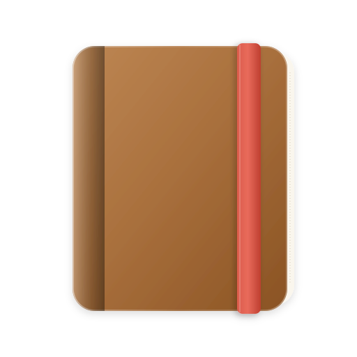
  </a>

  # Folio

  **Every loose note on your PC, gathered into one tactile notebook.**  
  <sub>Without moving, importing, or locking your files. 100% offline & private by default.</sub>

  <p>
    <a href="releases/Folio.exe"><strong>Download Folio (.exe)</strong></a> &nbsp;&bull;&nbsp;
    <a href="#why-folio">Why Folio?</a> &nbsp;&bull;&nbsp;
    <a href="#key-features">Features</a> &nbsp;&bull;&nbsp;
    <a href="#keyboard-shortcuts">Shortcuts</a> &nbsp;&bull;&nbsp;
    <a href="#privacy--offline-architecture">Privacy</a> &nbsp;&bull;&nbsp;
    <a href="#español"><strong>🇪🇸 Español (Desplegar)</strong></a> &nbsp;&bull;&nbsp;
    <a href="README.es.md">README.es.md</a>
  </p>

  <br />

  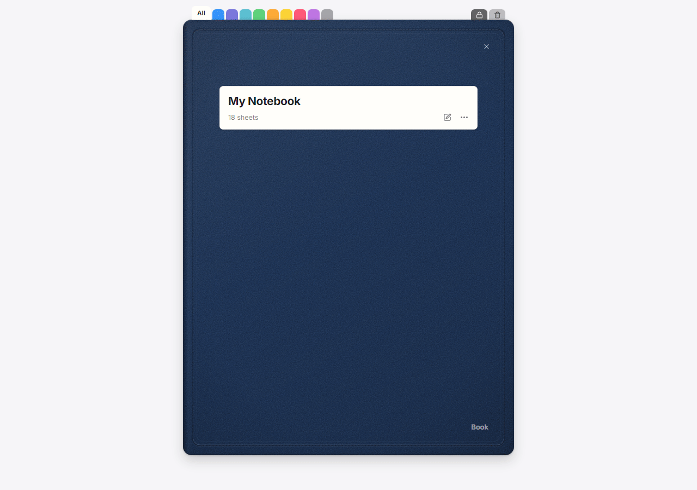

</div>

---

<details id="español">
<summary><strong>🇪🇸 Ver este README en Español (Clic para desplegar)</strong></summary>

> **Guía completa en español de Folio**  
> Todas las notas dispersas de tu PC, reunidas en un único cuaderno visual.

---

## ¿Por qué Folio?

Tus notas suelen quedar desparramadas por todos lados: pestañas sin guardar del Bloc de notas de Windows 11, Notas rápidas (Sticky Notes), y archivos `.txt` y `.md` sueltos en el Escritorio, Descargas y Documentos.

La mayoría de los programas de notas te exigen migrar, importar o encerrar tus ideas en formatos propietarios o servidores en la nube.

**Folio propone el camino inverso:**

1. **Cero migración**: Folio escanea las carpetas que elijas, lee las pestañas abiertas del Bloc de notas (incluso las no guardadas) y Sticky Notes, y las presenta en un cuaderno de papel rayado ordenadas por fecha.
2. **Edición en el lugar**: Folio no es una jaula. Cuando hacés doble clic en una hoja para escribir, **edita tu archivo `.txt` o `.md` original en el lugar exacto donde está en tu disco**, respetando su codificación y saltos de línea.
3. **100% sin conexión y privado por defecto**: Sin cuentas de usuario, sin telemetría, sin rastreo y sin depender de conexión a internet. Todo funciona en tu propia PC.

---

## Descarga y uso (Para usuarios)

Para usar **Folio** **no hace falta instalar herramientas de programación ni dependencias**:

1. Entrá a [**Releases**](../../releases) y descargá `Folio.exe` (o el archivo `.zip` de la versión).
2. Abrí `Folio.exe` directamente — está listo para usar en Windows 10 y Windows 11.

---

## Funcionalidades principales

### 1. Detección automática y sincronización en vivo
- **Recorre las carpetas elegidas**: Vigila tus ubicaciones preferidas salteando directorios de compilación o ruido (`node_modules`, `.git`, `AppData`, etc.).
- **Pestañas del Bloc de notas de Windows 11**: Lee las pestañas abiertas, incluso aquellas que aún no fueron guardadas en disco.
- **Sticky Notes**: Integra las notas rápidas de Windows en tu línea de tiempo.
- **Vigilancia del sistema de archivos en tiempo real**: Cuando un archivo cambia afuera, su hoja en Folio se actualiza de inmediato.

---

### 2. Escribir y dar formato sobre papel rayado
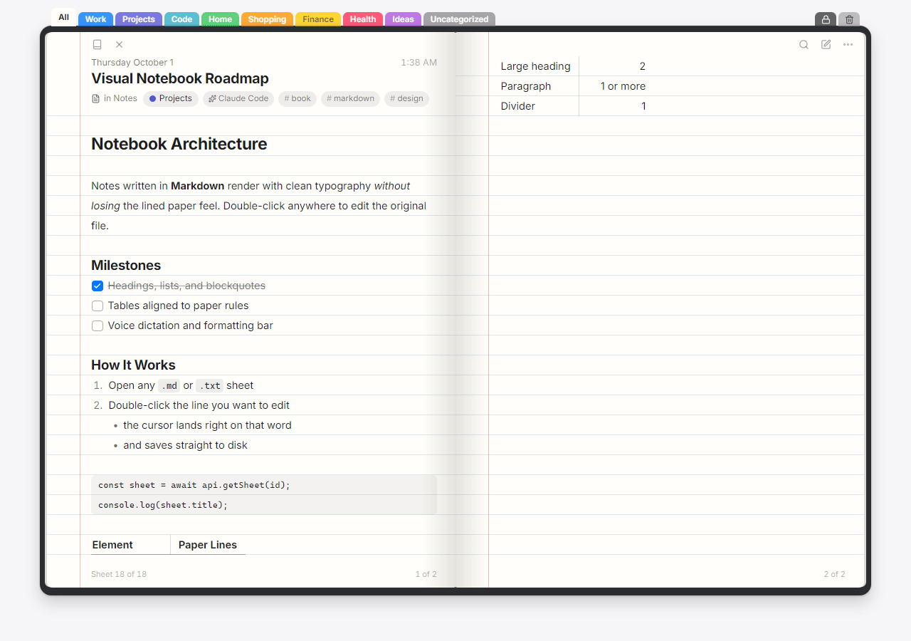

- **Doble clic para escribir**: Hacé doble clic en cualquier renglón de una hoja `.txt` o `.md` (o presioná `Enter`) para escribir. El cursor va exactamente al carácter donde hiciste clic.
- **Formato Markdown sobre el rayado**: Títulos, listas, casillas de tareas interactivas (`- [ ]`), tablas, bloques de código, citas y enlaces se dibujan alineados al renglón del papel.
- **Tareas interactivas**: Marcá o desmarcá tareas con un solo clic directamente sobre la vista Markdown.
- **Barra de formato y dictado por voz**: Botones rápidos de formato y un botón de micrófono para activar el dictado por voz de Windows (`Win + H`) sin perder el foco de escritura.
- **Notas nuevas como archivos reales**: Cada hoja nueva que creás en Folio (`Ctrl + N`) se guarda como un archivo `.txt` o `.md` estándar en `Documents/Folio`, pudiendo elegir su categoría desde el encabezado.

---

### 3. Captura desde cualquier programa
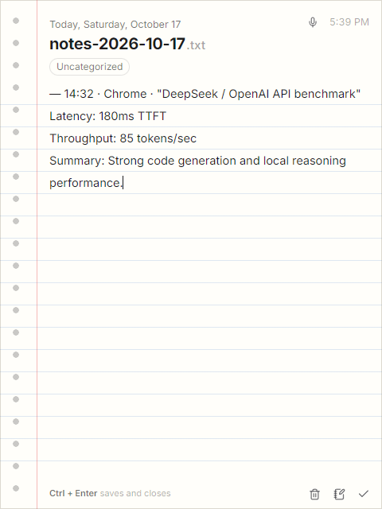

- **`Ctrl + Alt + B` (Abrir o minimizar Folio)**: Trae tu cuaderno al frente desde cualquier programa o lo vuelve a guardar en la bandeja al presionarlo de nuevo.
- **`Ctrl + Alt + N` (Hoja suelta rápida)**: Abre una hoja flotante siempre encima de las demás ventanas. Al cerrarla se guarda en el cuaderno; si querés descartarla, pide un segundo clic de confirmación por seguridad.
- **`Ctrl + Alt + X` (Enviar lo seleccionado a Folio)**: Seleccioná texto en cualquier navegador, lector de PDF, consola o editor y presioná `Ctrl + Alt + X`. Folio guarda el fragmento junto con la hora exacta, el programa y el título de la ventana de origen en una hoja de recortes **diaria** (`recortes-AAAA-MM-DD.txt`), **semanal**, **mensual** o **única**, o lo abre en una hoja suelta. Podés configurar si querés incluir u omitir el origen en Ajustes.

---

### 4. Categorías inteligentes y clasificador con IA opcional
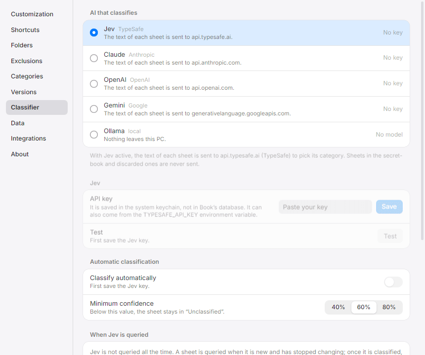

- **Sugerencia de categorías 100% local**: Agrupamiento estadístico de palabras y catálogo de temas que analiza tus notas en la propia PC sin enviar ni un solo byte a internet.
- **Clasificación automática en segundo plano**: Clasifica notas nuevas (o sugiere tus categorías iniciales) usando el proveedor de IA que prefieras:
  - **Ollama**: 100% local, gratuito y sin conexión.
  - **Claude** (Anthropic)
  - **OpenAI** (modelos GPT)
  - **Gemini** (Google)
  - **Jev**
- **Seguridad en el llavero nativo**: Las claves API se guardan únicamente en el **Administrador de credenciales de Windows**, nunca en texto plano ni en la base de datos.

---

### 5. Skills para asistentes de IA (Claude Code, Codex y Gemini CLI)
- **Instalación en un clic**: Desde **Ajustes → Integraciones**, instalá las instrucciones y skills oficiales directamente en:
  - `~/.claude/skills/folio-notes/SKILL.md` (Claude Code)
  - `~/.codex/AGENTS.md` (Codex CLI)
  - `~/.gemini/GEMINI.md` (Gemini CLI)
- **Toma de notas para tus agentes**: Pedile a tus agentes de consola (`"anotá esto en Folio"`, `"guardá esta decisión de arquitectura"`) y tomarán notas formateadas con encabezado YAML (`titulo`, `categoria`, `etiquetas`, `fuente`, `fecha`) listas para leer en el cuaderno.

---

### 6. Cuaderno secreto cifrado (`XChaCha20-Poly1305`)
- **Detección automática de credenciales**: Las notas que contienen contraseñas, tokens de acceso o claves privadas se apartan automáticamente al `secret-book`.
- **Aisladas de búsquedas y clasificadores**: Quedan fuera de la búsqueda global de texto y de las consultas a IAs.
- **Cifrado autenticado**: Se guardan cifradas en SQLite con `XChaCha20-Poly1305` mediante una clave gestionada por el Administrador de credenciales del sistema.
- **Clave de respaldo exportable**: Podés copiar tu clave de respaldo desde **Ajustes → Datos** para restaurar tus notas secretas en otro equipo o tras reinstalar el sistema.

---

### 7. Historial de versiones y recuperación de archivos
- **Instantáneas automáticas de versión**: Conserva versiones anteriores de tus notas (agrupadas por sesión de edición).
- **Recuperación tras borrado accidental**: Si borrás un archivo original o cerrás una pestaña sin guardar en el Bloc de notas, Folio mantiene la última versión conocida en **Ajustes → Datos**.
- **Renombrado y movimiento de carpetas**: Si un archivo o su carpeta cambia de nombre o se mueve de lugar, Folio lo reconoce y conserva su historial y categoría.

---

### 8. Tapas realistas, stickers y temas
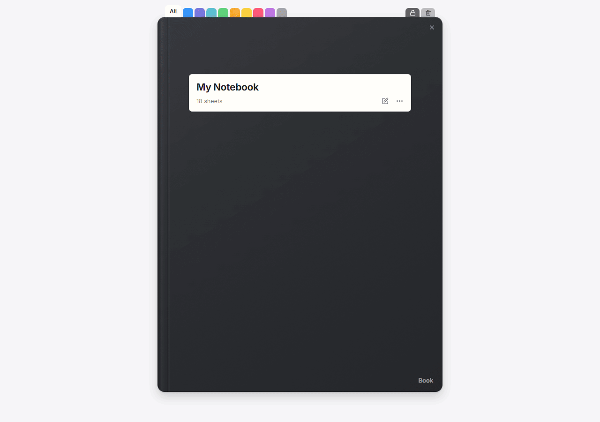

- **6 Estilos de tapa realistas**: Clásica (Lisa), Manchas (cuaderno de composición con lomo de cinta), Con tira (agenda elástica), Con lomo de tela, Cuero cosido, y más.
- **Colores personalizados e imágenes pegadas**: Elegí el color de la tapa o pegale imágenes y stickers (`Ctrl + V`) en la tapa y contratapa; acomodalas, rotalas y cambiales el tamaño a gusto.
- **Tema claro y oscuro**: Papel y tipografía adaptados para lectura diurna y nocturna.
- **Doble hoja, hoja simple con espiral y tamaño a medida**: Alterná entre vista de libro abierto a dos hojas o bloc de notas de una hoja con espiral metálico, en tamaño De bolsillo, Estándar, Pantalla completa o A medida (`Mayús + arrastrar`). Ajustes se adapta dentro del cuaderno o se abre en ventana propia con un clic.
- **Sonidos acústicos en tiempo real**: Sonidos suaves de pasar página, escribir y borrar, sintetizados al instante con la Web Audio API.
- **Interfaz bilingüe completa**: Español e inglés en todas las pantallas, diálogos, bandeja del sistema y notificaciones.

---

## Galería visual

<div align="center">

| Tema claro (Doble hoja) | Tema oscuro (Doble hoja) |
|:---:|:---:|
| 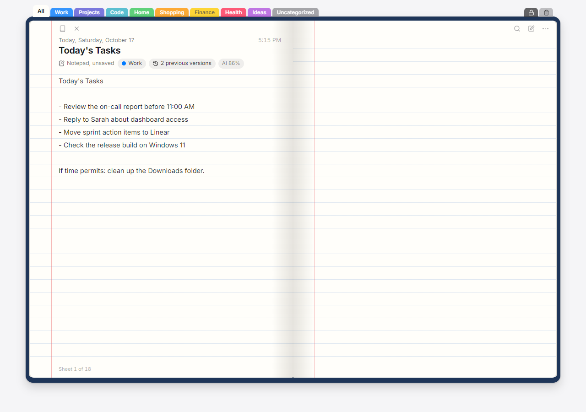 | 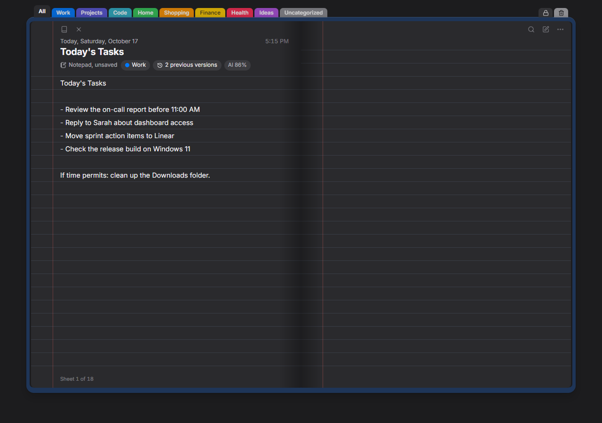 |

| Buscador, separadores y calendario | Hoja suelta de captura rápida |
|:---:|:---:|
| 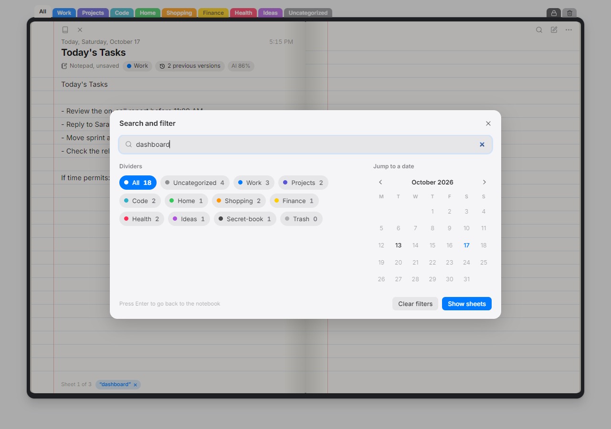 |  |

</div>

---

## Atajos de teclado

Todos los atajos pueden personalizarse en **Ajustes → Atajos** (`Ctrl + ,`).

### Atajos globales (Válidos desde cualquier programa)
| Atajo | Acción | Descripción |
|:---|:---|:---|
| `Ctrl + Alt + B` | Abrir o minimizar Folio | Muestra el cuaderno al frente o lo guarda en la bandeja |
| `Ctrl + Alt + N` | Hoja suelta de captura | Abre una hoja flotante para anotar algo rápido |
| `Ctrl + Alt + X` | Enviar lo seleccionado a Folio | Copia el texto seleccionado en cualquier programa junto con su origen |

### Atajos del cuaderno
| Atajo | Acción | Descripción |
|:---|:---|:---|
| `Flecha derecha` / `AvPág` | Página siguiente | Pasa de hoja hacia adelante |
| `Flecha izquierda` / `RePág` | Página anterior | Pasa de hoja hacia atrás |
| `Inicio` (Home) | Primera hoja | Va a la tapa delantera y primera hoja |
| `Fin` (End) | Última hoja | Va a la última hoja del cuaderno |
| `Enter` / `F2` | Escribir en la hoja | Doble clic o Enter para editar la hoja actual |
| `Ctrl + N` | Nueva hoja | Crea una nueva nota en `Documents/Folio` |
| `Ctrl + F` | Buscar y filtrar | Abre el buscador con texto completo, categorías y calendario |
| `Ctrl + ,` | Ajustes | Abre la ventana de configuración y personalización |
| `V` | Dar vuelta el cuaderno | Alterna entre la tapa y la contratapa (con el cuaderno cerrado) |
| `Escape` | Volver / Cerrar diálogo | Cierra modales, sale del modo escritura o vuelve de la papelera |
| `Mayús + Arrastrar` | Tamaño a medida | Mantené Mayús y arrastrá un borde o esquina para redimensionar |

---

## Privacidad y arquitectura offline

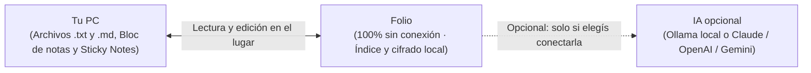

- **Tus notas originales no se tocan**: Folio no traslada tus notas a carpetas ocultas ni modifica sus formatos.
- **Almacenamiento y cifrado local**: El índice de búsqueda, el historial de versiones y las hojas secretas cifradas con `XChaCha20-Poly1305` quedan en tu equipo.
- **Claves protegidas**: Las credenciales opcionales de IA viven únicamente en el llavero nativo del sistema operativo.
- **Cero telemetría**: Folio no contiene analíticas, rastreadores ni conexiones en segundo plano.

---

## Compilar desde el código fuente (Para desarrolladores)

> [!NOTE]
> **No necesitás instalar nada de esto para usar Folio**: si solo querés usar el programa, descargá directamente `Folio.exe` desde [Releases](../../releases). Estas herramientas son únicamente para quienes quieran modificar el código o compilar el proyecto por su cuenta.

### Requisitos de desarrollo
- [Node.js](https://nodejs.org) (v22 o superior)
- [pnpm](https://pnpm.io)
- [Rust](https://www.rust-lang.org) (canal estable)
- Herramientas de compilación de C++ (en Windows, mediante el instalador de Visual Studio)

### Comandos de desarrollo

```bash
# Clonar el repositorio
git clone https://github.com/Joaquin-H/folio.git
cd folio

# Instalar dependencias
pnpm install

# Iniciar la aplicación completa (Tauri + Vite)
pnpm tauri dev

# Iniciar solo la interfaz con datos de muestra
pnpm dev

# Correr pruebas unitarias del backend en Rust
cargo test --manifest-path src-tauri/Cargo.toml

# Verificar consistencia de traducciones
pnpm i18n

# Compilar ejecutable optimizado (salida: src-tauri/target/release/folio.exe)
pnpm tauri build --no-bundle
```

---

## Licencia

Este proyecto se distribuye bajo la **Licencia MIT con Commons Clause** — consultá el archivo [LICENSE](LICENSE) para más detalles. Podés usar, estudiar, modificar y redistribuir el software gratuitamente para uso personal o interno, pero no está permitida su venta comercial.

</details>

---

## Why Folio?

Your notes are probably scattered everywhere: unsaved tabs left open in Windows 11 Notepad, quick Sticky Notes, and scratchpad `.txt` and `.md` files spread across your Desktop, Downloads, and Documents.

Most note-taking apps ask you to migrate, import, or lock your thoughts into proprietary databases or cloud servers.

**Folio takes the opposite approach:**

1. **Zero Migration**: Folio scans your chosen folders, reads open Windows 11 Notepad tabs (even unsaved ones), and Sticky Notes, presenting them chronologically in an authentic lined-paper notebook.
2. **In-Place Editing**: Folio is not a silo. When you double-click a sheet to write, **it edits your original `.txt` or `.md` file directly where it sits on your disk**, preserving its original encoding and line endings.
3. **100% Offline & Private by Default**: No user accounts, no telemetry, no tracking, and no internet connection required. Everything lives on your PC.

---

## Download & Run (For Users)

To use **Folio**, **no technical prerequisites or installers are needed**:

1. Go to [**Releases**](../../releases) and download `Folio.exe` (or the release `.zip` archive).
2. Open `Folio.exe` directly — it runs out of the box on Windows 10 and Windows 11.

---

## Key Features

### 1. Automatic Discovery & Live Sync
- **Scans your chosen locations**: Keeps watch over your selected directories while ignoring noisy build folders (`node_modules`, `.git`, `AppData`, etc.).
- **Reads Windows 11 Notepad tabs**: Accesses open and unsaved Notepad tabs seamlessly.
- **Reads Sticky Notes**: Integrates your Windows Sticky Notes into the timeline.
- **Live filesystem watcher**: When a file changes on disk, its sheet in Folio updates immediately.

---

### 2. Write & Format on Lined Paper


- **Write anywhere with a double-click**: Double-click any line on a `.txt` or `.md` sheet (or hit `Enter`) to enter writing mode. The cursor lands on the exact character you clicked.
- **Rich Markdown rendering**: Headings, lists, interactive task checkboxes (`- [ ]`), tables, code blocks, blockquotes, and links render directly aligned to the paper rules.
- **Interactive tasks**: Click any checkbox in Markdown view to check or uncheck tasks instantly.
- **Formatting toolbar & voice dictation**: One-click formatting tools and a dedicated voice dictation button (`Win + H` on Windows) keep writing fluid.
- **Real file creation & categories**: New sheets created in Folio (`Ctrl + N`) are saved as standard `.txt` or `.md` files in `Documents/Folio`, with instant category assignment right from the sheet header.

---

### 3. Capture from Anywhere


- **`Ctrl + Alt + B` (Toggle Folio)**: Summon your notebook to the front from any app, or press it again to hide it back to the tray.
- **`Ctrl + Alt + N` (Quick Capture Sheet)**: Open a floating scratchpad sheet pinned on top of all windows. Close it to save it directly into Folio, or discard it with safety confirmation.
- **`Ctrl + Alt + X` (Send Selection to Folio)**: Select text anywhere — in Chrome, Edge, Firefox, a PDF reader, terminal, or IDE — and hit `Ctrl + Alt + X`. Folio captures the snippet along with its exact timestamp, source app name, and window title into a **daily** (`recortes-YYYY-MM-DD.txt`), **weekly**, **monthly**, or **single universal** clippings sheet, or opens it in a floating sheet. You can also toggle whether to include or omit the source header in Settings.

---

### 4. Smart Categories & Optional AI Classifier


- **100% Local Category Suggestion**: Built-in statistical word clustering and a curated topic catalog analyze your existing notes on your PC without transmitting a single byte to the internet.
- **Multi-Provider AI Classification**: Automatically categorizes newly added notes in the background (or suggests initial categories) using your choice of model:
  - **Ollama**: 100% local, free, zero network required.
  - **Claude** (Anthropic)
  - **OpenAI** (GPT models)
  - **Gemini** (Google)
  - **Jev**
- **Hardware-backed security**: API keys are saved exclusively in your operating system's native keychain (**Windows Credential Manager**), never in plain text or SQLite.

---

### 5. AI Assistant Skills (Claude Code, Codex & Gemini CLI)
- **1-Click Skill Installation**: From **Settings → Integrations**, install official skills and prompts directly into:
  - `~/.claude/skills/folio-notes/SKILL.md` (Claude Code)
  - `~/.codex/AGENTS.md` (Codex CLI)
  - `~/.gemini/GEMINI.md` (Gemini CLI)
- **Agent Note Taking**: Instruct your terminal AI agents (`"take a note in Folio"`, `"save this architecture decision"`) and they will write formatted `.md` notes with YAML frontmatter (`title`, `category`, `tags`, `source`, `date`) that slot into your visual notebook.

---

### 6. Encrypted Secret-Book (`XChaCha20-Poly1305`)
- **Automatic credential detection**: Notes containing private keys, access tokens, API secrets, or passwords are automatically separated from regular notes.
- **Isolated from search & classifiers**: Secret sheets are excluded from standard full-text search and AI classification pipelines.
- **Authenticated encryption**: Encrypted in the database with `XChaCha20-Poly1305` using an encryption key stored in the OS credential manager.
- **Exportable recovery key**: Back up or restore your encryption key from **Settings → Data** to recover secret sheets on another machine.

---

### 7. Version History & Missing File Recovery
- **Automatic revision snapshots**: Folio retains previous versions of your notes (one version per editing session).
- **Accidental deletion recovery**: If you delete an original file or close an unsaved Notepad tab, Folio preserves the last known snapshot in `Settings → Data` so nothing is lost.
- **File renaming and moves**: If a file or its parent folder is moved or renamed, Folio recognizes its identity and preserves its history and category.

---

### 8. Realistic Covers, Stickers & Themes


- **6 Realistic tactile cover styles**: Classic (Plain), Spots (composition notebook with taped spine), Strap (elastic band), Fabric spine, Stitched leather, and more.
- **Custom colors & stickers**: Choose leather and cover tones, or paste images (`Ctrl + V`) and stickers onto front and back covers; move, resize, and rotate them freely.
- **Light & Dark themes**: Seamless paper and UI styling for day and night.
- **Two-page spread, Single-sheet spiral & Custom sizing**: Choose between a bound two-page book or a single-sheet notepad with a metallic spiral coil, in Pocket, Standard, Fullscreen, or Custom (`Shift + drag`) sizes. Settings adapt inside the window or pop out into a dedicated window with one click.
- **Tactile procedural audio**: Subtle acoustic sounds for turning pages, typing, and deleting — synthesized entirely in real-time with Web Audio API.
- **Full bilingual support**: English and Spanish across every screen, dialog, system tray, and notification.

---

## Visual Gallery

<div align="center">

| Light Theme (Two-Page Spread) | Dark Theme (Two-Page Spread) |
|:---:|:---:|
|  |  |

| Finder, Categories & Calendar | Quick Capture Floating Sheet |
|:---:|:---:|
|  |  |

</div>

---

## Keyboard Shortcuts

All shortcuts can be customized in **Settings → Shortcuts** (`Ctrl + ,`).

### Global Shortcuts (Active Everywhere)
| Shortcut | Action | Description |
|:---|:---|:---|
| `Ctrl + Alt + B` | Toggle Folio | Opens Folio or hides it back to the tray |
| `Ctrl + Alt + N` | Quick capture sheet | Opens a floating paper sheet to jot down notes quickly |
| `Ctrl + Alt + X` | Send selection to Folio | Copies selected text from any app and saves it with its source |

### Notebook Shortcuts
| Shortcut | Action | Description |
|:---|:---|:---|
| `ArrowRight` / `PageDown` | Next page | Turn page forward |
| `ArrowLeft` / `PageUp` | Previous page | Turn page backward |
| `Home` | First sheet | Jump to the front cover and first sheet |
| `End` | Last sheet | Jump to the last sheet of the notebook |
| `Enter` / `F2` | Write on sheet | Double-click or press Enter to edit current sheet |
| `Ctrl + N` | New sheet | Create a new sheet in `Documents/Folio` |
| `Ctrl + F` | Search and filter | Open Finder with full-text search, categories, and calendar |
| `Ctrl + ,` | Settings | Open customization and configuration dialog |
| `V` | Flip notebook | Flip between front cover and back cover (when closed) |
| `Escape` | Back / Close dialog | Close dialogs, exit writing mode, or return from trash |
| `Shift + Drag` | Custom size | Hold Shift and drag book corner/edge to resize freely |

---

## Privacy & Offline Architecture

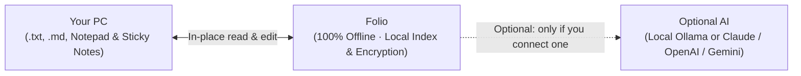

- **Original files remain untouched**: Folio never moves your files into hidden locations or changes their formats.
- **Local storage & encryption**: Your search index, version history, and `XChaCha20-Poly1305` encrypted secret sheets stay on your computer.
- **OS keychain security**: Optional AI keys are stored exclusively in the native operating system credential manager.
- **Telemetry-free**: Folio contains no analytics, no tracking, and no background network calls.

---

## Building from Source (For Developers)

> [!NOTE]
> You **do not** need any of the tools below to use Folio — simply download `Folio.exe` from [Releases](../../releases). The prerequisites below are only required if you want to modify the source code or compile Folio yourself.

### Prerequisites for Development
- [Node.js](https://nodejs.org) (v22 or newer)
- [pnpm](https://pnpm.io)
- [Rust](https://www.rust-lang.org) (stable toolchain)
- C++ Build Tools (on Windows, via Visual Studio Installer)

### Development Commands

```bash
# Clone the repository
git clone https://github.com/Joaquin-H/folio.git
cd folio

# Install frontend dependencies
pnpm install

# Run complete application (Tauri + Vite)
pnpm tauri dev

# Run frontend-only with mock data
pnpm dev

# Run Rust backend unit tests
cargo test --manifest-path src-tauri/Cargo.toml

# Verify i18n translation coverage
pnpm i18n

# Build optimized desktop binary (output: src-tauri/target/release/folio.exe)
pnpm tauri build --no-bundle
```

---

## License

This project is licensed under the **MIT License with Commons Clause** — see the [LICENSE](LICENSE) file for full details. You are free to use, study, modify, and redistribute the software for personal or internal use, provided it is not sold as a commercial product or paid service.

---

<div align="center">
  <sub>Built with <strong>Tauri 2</strong> &bull; <strong>Rust</strong> &bull; <strong>React 19</strong> &bull; <strong>SQLite FTS5</strong> &bull; Part of the <strong>J-Playground</strong> ecosystem.</sub>
</div>

